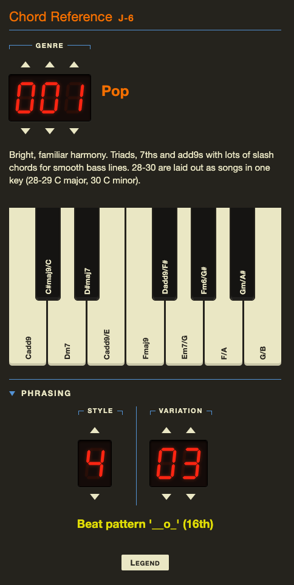

# J-6 Chords

A quick-reference page for the Roland AIRA Compact J-6: what chords each chord set plays, and what each style and variation does. Built for a phone, works offline.



## Using it

There are two separate lookups.

**Genre** (top). Pick a chord set, 1–100. The page shows the genre name, a short description, and a one-octave keyboard with the chord each key plays. Hold a key to see that chord's notes: the chord names fade out, and the keys it uses light up, labelled with their octaves (e.g. `C3`, `D4`).

**Phrasing** (bottom, collapsed by default). Pick a style (1–9) and a variation (1–12) to see what the J-6 plays, e.g. `Arp 16ths up 1`. The style shows as soon as it's set and the variation is added once chosen. Styles 6–9 have no named variations, so only the style is shown. **Legend** explains the rhythm symbols used in the beat patterns.

**Inputs.** Each digit is set on its own. Swipe up or down on a digit, or tap the triangles above and below it, to step by one. Digits wrap around, and the ranges are limited so you can't enter an invalid number. At 0 nothing is shown.

## Reference data

Chord sets, styles and genre descriptions come from the J-6 Owner's Manual v1.02 and live in [`docs/ref`](docs/ref). The manual mislabels some chords. The data corrects their names and records the manual's original name and the reason; the page doesn't show those yet. See [`docs/ref/README.md`](docs/ref/README.md) for the fields and how they were checked.

## Development

Requires Node 22.12+.

```bash
npm install
npm run dev      # local dev server
npm test         # unit and component tests (Vitest, jsdom)
npm run build    # typecheck, then build dist/index.html
```

The build is a single `dist/index.html` with all scripts, styles and data inlined, so it needs no network. Serve it from any static host, or on your local network with `npm run preview -- --host`.

Code layout: lookups and digit logic are pure functions in `src/lib`; `src/components` is the Preact UI on top.
